## 1. Data-Science-Prozesse mit BPMN gestalten {#bpmn-einstieg}

### Die eigene Arbeit als Prozess

Ein Data-Science-Projekt verbindet eine fachliche Frage mit Daten, Methoden und einer praktischen Verwendung der Ergebnisse. Wenn KI Aufgaben übernimmt, verändern sich auch die Übergaben zwischen Fachbereich, Analyseteam und technischen Systemen.

Der Data-Science-Lifecycle hilft, diese Arbeit in Phasen einzuordnen. Ein Prozessmodell zeigt genauer, wer welche Aufgabe erledigt, welche Daten benötigt werden und wann eine Prüfung den nächsten Schritt erlaubt. So wird auch der eigene Beitrag sichtbar.

Prozessmanagement (Business Process Management, BPM) untersucht und verbessert solche Abläufe. BPMN steht für Business Process Model and Notation. Diese standardisierte Zeichensprache beschreibt Abläufe mit Ereignissen, Aufgaben und Verbindungen.

### Plan, Data, Model und Deployment

Der Data-Science-Lifecycle ordnet die Arbeit in vier Bereiche. Rückwege gehören zu einem Analyseprojekt: Ein Ergebnis kann neue Daten oder eine präzisere Fragestellung erfordern.


**Plan:** Den Anwendungsfall auswählen, die Fragestellung eingrenzen, Variablen bestimmen und Erfolgskriterien festlegen.

**Data:** Daten beschaffen, ihre Herkunft und Struktur prüfen, Daten aufbereiten und erkunden. Bei Prognosen die spätere Testmenge vor datenabhängigen Modellentscheidungen abtrennen.

**Model:** Eine geeignete Methode auswählen, Modelle trainieren und auf Validierungsdaten vergleichen. Bei einer beschreibenden Analyse genügen passende Kennzahlen und Darstellungen.

**Deployment:** Das Ergebnis oder Modell für die Verwendung bereitstellen. Annahmen, Grenzen und Zuständigkeiten dokumentieren; die Leistung im Einsatz beobachten.

### Entscheidung und Arbeitsablauf verbinden

Die Entscheidungsfolge aus Frage, Plan, Daten, Analyse, Report, Aktion und Evaluation beschreibt den Weg zum fachlichen Nutzen. Der Lifecycle ordnet die technische und analytische Arbeit darin ein: Plan präzisiert die Frage, Data und Model tragen zur Analyse bei, Deployment verbindet die Nutzung mit der weiteren Beobachtung.

BPMN macht einen konkreten Ausschnitt ausführlich sichtbar. Beim Datencheck etwa: Eine Person stellt eine Datei bereit, das Analyseteam prüft ihre Qualität, und bei fehlenden Angaben geht eine Rückfrage an die Datenquelle. Aufgabe, Verantwortung und Rückweg werden später einzeln modelliert.

### Von Phasen zu konkreten Arbeitsschritten


Der Lifecycle ordnet die Arbeit fachlich ein. BPMN beschreibt einen konkreten Ablauf innerhalb oder zwischen den Phasen, einschließlich Zuständigkeiten und Rückwegen.

Ein Prüfungsergebnis kann eine Rückkehr auslösen: Ungeeignete Daten erfordern weitere Datenklärung; ein unzureichendes Modell kann eine andere Aufbereitung benötigen.

Die Reihenfolge hängt vom Projekt ab. Die vier Bereiche ergeben deshalb nicht automatisch eine feste Kette von Aufgaben. Ein fachlich lesbares Diagramm allein ist noch keine ausführbare Automatisierung.

### Übung: Einen eigenen Analyseprozess abgrenzen

Voraussetzung: Ein wiederkehrender Analyseablauf aus dem eigenen Arbeitsumfeld, ohne vertrauliche Angaben.

1. Den Auslöser des Ablaufs benennen.
2. Das verwendbare Ergebnis notieren.
3. Die Arbeitsschritte zwischen Auslöser und Ergebnis beschreiben.
4. Zu jedem Schritt die verantwortliche Rolle ergänzen.
5. Die Schritte Plan, Data, Model und Deployment zuordnen.
6. Eine Übergabe markieren, an der Rückfragen entstehen.
7. Einen Rückweg nach einer nicht bestandenen Prüfung ergänzen.

Prüfkriterium: Die Beschreibung enthält Auslöser, Ergebnis, Zuständigkeiten und einen begründeten Rückweg.

Beispiel ohne eigenen Fall: Eine Analyseanfrage wird konkretisiert, mit bereitgestellten Daten bearbeitet und fachlich geprüft.

## 2. Grundelemente und gute Namen {#bpmn-grundelemente}

### Einen Analyseablauf modellieren

Eine Analyse liefert einen Bericht, dessen Aussagen vor der Verwendung fachlich geprüft werden. Die Prüfung gehört zur Bewertung im Data-Science-Lifecycle. Die anschließende Freigabe verbindet sie mit der Bereitstellung und Nutzung.

Dieser Ausschnitt beginnt mit dem Eingang des Berichts und endet mit seiner Freigabe. BPMN zeigt die konkreten Aufgaben zwischen diesen Zuständen. Bei beanstandeten Ergebnissen ist zusätzlich ein Rückweg zur Überarbeitung nötig.

Ob eine Aufgabe durch Menschen, Python oder einen KI-Dienst ausgeführt wird, muss zusätzlich festgelegt werden. Eine Lifecycle-Phase kann viele solcher Aufgaben enthalten.

### Start und Ende

Die Pfeile geben die Leserichtung des Modells vor.


**Startereignis**: Ein Kreis mit dünner Linie markiert den Beginn. Sein Name beschreibt den eingetretenen Zustand. Beispiel: „Bericht eingegangen“.

**Endereignis**: Ein Kreis mit dicker Linie markiert ein Ergebnis. Ein Prozess kann unterschiedliche Enden haben, etwa „Bericht freigegeben“ und „Bericht zurückgewiesen“.

### Aufgabe und Sequenzfluss


**Aufgabe**: Ein abgerundetes Rechteck beschreibt einen Arbeitsschritt. Der Name nennt Objekt und Verb im Infinitiv, etwa „Bericht prüfen“.

**Sequenzfluss**: Ein durchgezogener Pfeil legt die Reihenfolge innerhalb eines Prozesses fest. Nach „Bericht prüfen“ folgt hier „Bericht freigeben“.

### Das Berichtsmodell erkunden


**Startereignis:** Der dünne Kreis heißt „Bericht eingegangen“. Hier beginnt der Ablauf.

**Aufgabe:** Das abgerundete Rechteck „Bericht prüfen“ nennt eine Arbeit mit Objekt und Verb.

**Sequenzfluss:** Der durchgezogene Pfeil führt von „Bericht prüfen“ zu „Bericht freigeben“.

**Endereignis:** Der dicke Kreis heißt „Bericht freigegeben“. Er zeigt den erreichten Zustand.
### Aufgaben und Ereignisse benennen


Ein Aufgabenname beschreibt eine Tätigkeit mit Objekt und Verb: „Kennzahl berechnen“ oder „Bericht freigeben“. „Analyse bearbeiten“ bleibt zu breit.

Ein Ereignisname beschreibt einen Zustand: „Daten bereitgestellt“ oder „Bericht freigegeben“. „Ende“ allein erklärt das erreichte Ergebnis nicht.

### Selbstcheck: Aufgabennamen prüfen

Welche Namen beschreiben eine konkrete Tätigkeit?

Kategorien: Konkrete Tätigkeit, Unklare Tätigkeit.

1. Fehlende Werte zählen
2. Datenqualität
3. Kennzahl berechnen
4. Daten bearbeiten

<details>
<summary>Lösung und Begründung</summary>

- Fehlende Werte zählen: **Konkrete Tätigkeit**
- Datenqualität: **Unklare Tätigkeit**
- Kennzahl berechnen: **Konkrete Tätigkeit**
- Daten bearbeiten: **Unklare Tätigkeit**

„Fehlende Werte zählen“ und „Kennzahl berechnen“ nennen konkrete Handlungen. „Datenqualität“ enthält keine Tätigkeit. „Daten bearbeiten“ lässt offen, welche Bearbeitung gemeint ist.

</details>
### Selbstcheck: Ereignisse benennen

Welche Beschriftung benennt für ihr Element kein klares Ergebnis?

1. Startereignis: Daten bereitgestellt
2. Aufgabe: Fehlende Werte zählen
3. Aufgabe: Qualitätsbericht speichern
4. Endereignis: Fertig

<details>
<summary>Lösung und Begründung</summary>

- Endereignis: Fertig

„Fertig“ lässt das Ergebnis offen. „Qualitätsbericht gespeichert“ beschreibt den erreichten Zustand.

</details>
### Prosa in Modellelemente übersetzen


**Tätigkeiten** werden zu Aufgaben. „Die Analystin prüft die Datentypen“ ergibt „Datentypen prüfen“.

**Bedingungen** machen eine Verzweigung nötig. „Bei fehlenden Spalten die Datei zurückgeben“ enthält eine Entscheidung und eine Aufgabe auf einem Pfad.

### Zeitangaben und Ergebnisse erkennen


**Auslöser und Wartezeiten** verweisen auf Ereignisse. „Nach Eingang der Datei“ und „bis zur Rückmeldung warten“ beschreiben unterschiedliche Stellen im Ablauf.

**Ergebnisse** beschreiben, wie ein Fall endet. Eine Datenprüfung kann mit „Datensatz angenommen“ oder „Datensatz zurückgegeben“ enden.

### Selbstcheck: Eine Beschreibung übersetzen

„Das Analyseteam prüft die Daten und fordert bei fehlenden Angaben eine Ergänzung an.“ Welche Struktur bildet das ab?

1. Eine Aufgabe: Daten prüfen und ergänzen lassen
2. Zwei Aufgaben in Reihe; eine Ergänzung wird immer angefordert
3. Prüfaufgabe, Verzweigung und Ergänzungsanforderung nur bei fehlenden Angaben

<details>
<summary>Lösung und Begründung</summary>

- Prüfaufgabe, Verzweigung und Ergänzungsanforderung nur bei fehlenden Angaben

Die Prüfung erzeugt ein Ergebnis. Dieses Ergebnis bestimmt den Pfad. Eine Ergänzung wird nur angefordert, wenn Angaben fehlen.

</details>
### Übung: Eine Berichtsfreigabe zeichnen

Voraussetzung: Browser mit Zugang zu demo.bpmn.io.

Fall: Ein Bericht geht ein, wird geprüft und anschließend freigegeben. In diesem vereinfachten Fall ist die Prüfung erfolgreich.

1. Den BPMN-Editor öffnen.
2. Ein neues Diagramm anlegen.
3. Das Startereignis benennen.
4. Für jede Tätigkeit eine eigene Aufgabe ergänzen.
5. Ein Endereignis mit dem erreichten Ergebnis ergänzen.
6. Die Elemente in der beschriebenen Reihenfolge verbinden.
7. Die Aufgaben prüfen: Jeder Name nennt Objekt und Tätigkeit.
8. Den Ablauf prüfen: Ein durchgehender Pfad verbindet Start und Ende.
9. Das Modell als bericht-freigeben.bpmn speichern.

[BPMN-Editor öffnen](https://demo.bpmn.io/)

<details>
<summary>Musterlösung: Berichtsfreigabe</summary>

Startereignis „Bericht eingegangen“, Aufgabe „Bericht prüfen“, Aufgabe „Bericht freigeben“, Endereignis „Bericht freigegeben“. Drei Sequenzflüsse verbinden die Elemente.

Die erfolgreiche Prüfung ist hier eine ausdrückliche Vereinfachung. Ein realer Freigabeprozess benötigt zusätzlich einen Pfad für beanstandete Berichte.


</details>

## 3. Gateways: verzweigen und zusammenführen {#bpmn-gateways}

### Entscheidungen im Analyseablauf

Im Data-Science-Lifecycle führen Prüfungen häufig zu Rückwegen. Ein ungeeigneter Datensatz braucht weitere Klärung; ein unzureichendes Modell kann eine andere Aufbereitung oder Methode erfordern. Die fachlichen Kriterien müssen dafür vorher feststehen.

Gateways sind Verzweigungs- und Zusammenführungspunkte. Die Raute steuert anhand vorliegender Ergebnisse den weiteren Ablauf. Die fachliche Prüfung steht als eigene Aufgabe davor.

### XOR: genau ein Pfad

Ein Token ist eine gedachte Marke für den aktuellen Stand eines Prozessfalls. Nach „Datensatz prüfen“ verzweigt „Datensatz geeignet?“ zu Analyse oder Rückgabe. Anschließend wird der Fachbereich benachrichtigt.

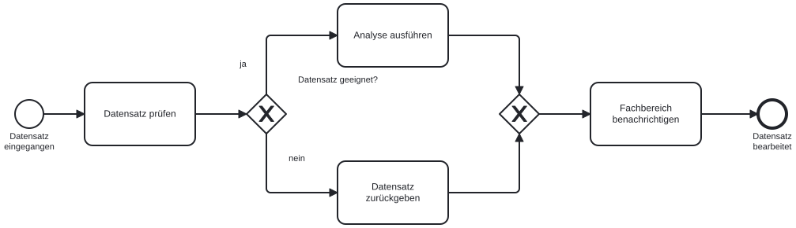

Ein **exklusives Gateway (XOR)** wählt genau einen ausgehenden Pfad. Seine Bedingungen müssen den Fall eindeutig zuordnen. Mehr als zwei Ausgänge sind möglich.

Eine **XOR-Zusammenführung** lässt jedes eintreffende Token sofort weiterlaufen. Sie wartet nicht auf andere Pfade.

### Selbstcheck: Versteckte Verzweigung

Welche Aufgabe versteckt eine notwendige Verzweigung?

1. Startereignis: Datei bereitgestellt
2. Aufgabe: Spalten prüfen und gegebenenfalls Datei zurückgeben
3. Aufgabe: Kennzahlen berechnen
4. Endereignis: Kennzahlen berechnet

<details>
<summary>Lösung und Begründung</summary>

- Aufgabe: Spalten prüfen und gegebenenfalls Datei zurückgeben

„Gegebenenfalls“ enthält eine Bedingung. Nach der Spaltenprüfung entscheidet ein Gateway über Berechnung oder Rückgabe. Auf dem Rückgabepfad darf die Kennzahlberechnung nicht unverändert weiterlaufen.

</details>
### AND: alle Pfade

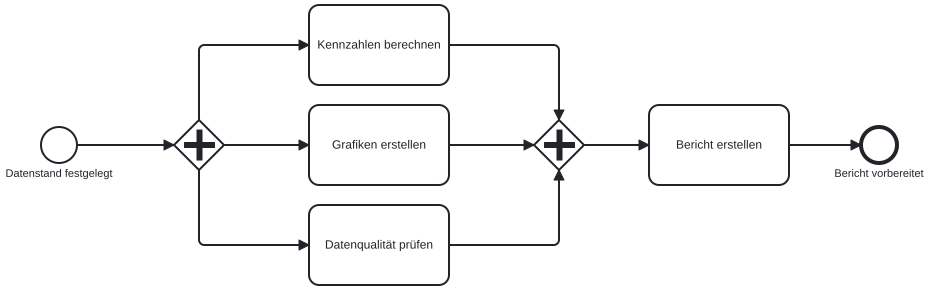

Ein **paralleles Gateway (AND)** startet alle ausgehenden Pfade ohne Bedingung. Im Beispiel werden Kennzahlen, Grafiken und ein Qualitätsbericht unabhängig erstellt. Alle verwenden denselben festgelegten Datenstand.

Eine **AND-Zusammenführung** wartet auf ein Token aus jedem eingehenden Pfad. Erst danach wird der Bericht zusammengestellt.

### OR: zutreffende Pfade

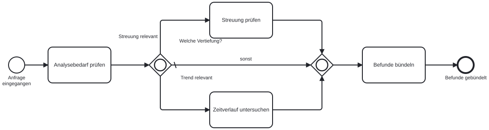

Ein **inklusives Gateway (OR)** startet alle Pfade, deren Bedingungen erfüllt sind. Bei einer Analyse können eine Verteilungsuntersuchung und eine Trenduntersuchung erforderlich sein.

Im gezeigten strukturierten Modell wartet die **OR-Zusammenführung** auf alle gestarteten Pfade. Ein nicht gestarteter Pfad hält die Zusammenführung nicht auf.

Der **Standardfluss** mit kleinem Querstrich wird gewählt, wenn keine Bedingung erfüllt ist. Hier geht es ohne zusätzliche Vertiefung zur Zusammenführung.

### Token verfolgen: XOR und AND

<iframe title="Token verfolgen: XOR und AND" src="bpmn/token-xor-and.html" sandbox="allow-scripts" style="width:100%;height:740px;border:1px solid #d8dce3" loading="lazy"></iframe>

[Animation in voller Breite öffnen](bpmn/token-xor-and.html)

### Token verfolgen: OR

<iframe title="Token verfolgen: OR" src="bpmn/token-or.html" sandbox="allow-scripts" style="width:100%;height:740px;border:1px solid #d8dce3" loading="lazy"></iframe>

[Animation in voller Breite öffnen](bpmn/token-or.html)

### Selbstcheck: Gateway auswählen

Welches Gateway bildet die beschriebene Verzweigung ab?

Kategorien: XOR, AND, OR.

1. Ein bewertetes Modell erfüllt entweder die vereinbarten fachlichen Kriterien oder muss überarbeitet werden.
2. Kennzahlen und Grafiken werden unabhängig erstellt; beide Ergebnisse sind immer erforderlich.
3. Je nach Fragestellung werden Unterschiede zwischen Gruppen, zeitliche Trends oder beides untersucht.
4. Die Daten werden in allen drei vereinbarten Formaten exportiert.

<details>
<summary>Lösung und Begründung</summary>

- Ein bewertetes Modell erfüllt entweder die vereinbarten fachlichen Kriterien oder muss überarbeitet werden.: **XOR**
- Kennzahlen und Grafiken werden unabhängig erstellt; beide Ergebnisse sind immer erforderlich.: **AND**
- Je nach Fragestellung werden Unterschiede zwischen Gruppen, zeitliche Trends oder beides untersucht.: **OR**
- Die Daten werden in allen drei vereinbarten Formaten exportiert.: **AND**

XOR wählt eine Alternative. AND startet alle genannten Pfade. OR startet die Untersuchungen, deren Bedingungen erfüllt sind, einschließlich des Falls „beides“.

</details>
### Zusammenführungen prüfen


Bei den hier gezeigten einfachen Verzweigungen passen Split und Join desselben Typs zusammen. Das ist eine Modellierungshilfe, keine allgemeine Pflicht für jedes BPMN-Modell.

Ein AND-Join nach einem XOR-Split wartet in diesem Modell auf einen Pfad, der nie gestartet wurde. Der Prozess bleibt stehen.

Ein XOR-Join nach einem AND-Split führt keine Synchronisation aus. Jeder ankommende Pfad startet die Folgeaufgabe erneut.

### Selbstcheck: Fehlerhafte Zusammenführung

Kennzahlen, Grafiken und Qualitätsbericht entstehen in drei parallelen Pfaden. Ein XOR-Join führt sie vor „Bericht erstellen“ zusammen. Was passiert, wenn alle drei Pfade eintreffen?

1. Die Berichtserstellung startet erst, wenn alle drei Ergebnisse vorliegen.
2. Die Berichtserstellung startet dreimal, einmal pro eintreffendem Pfad.
3. Kein Pfad kann das XOR-Gateway passieren.

<details>
<summary>Lösung und Begründung</summary>

- Die Berichtserstellung startet dreimal, einmal pro eintreffendem Pfad.

Ein XOR-Join lässt jedes Token weiterlaufen. Für das gemeinsame Warten auf alle drei Ergebnisse ist in dieser Struktur ein AND-Join nötig.

</details>
### Drei Analyseabläufe unterscheiden

Für jeden Fall das passende Gateway bestimmen: XOR, AND oder OR.

**Modellbewertung**

Ein Modell erfüllt die vereinbarten fachlichen Kriterien oder geht zur Überarbeitung zurück.

<details>
<summary>Begründung</summary>

**XOR:** Die beiden Ergebnisse schließen sich aus. Genau ein Pfad läuft.

**AND:** AND startet immer alle Pfade. Hier hängt die Auswahl vom Fall ab.

**OR:** Hier schließen sich Freigabe und Überarbeitung aus. Genau ein Ergebnis gilt, deshalb passt XOR.

</details>

**Berichtsvorbereitung**

Kennzahlen und Grafiken werden unabhängig erstellt. Beide Ergebnisse sind für den Bericht erforderlich.

<details>
<summary>Begründung</summary>

**XOR:** XOR lässt nur einen Pfad zu. Hier können oder müssen mehrere Pfade laufen.

**AND:** Beide Pfade sind immer erforderlich. AND startet beide und wartet auf beide.

**OR:** Hier sind beide Ergebnisse immer erforderlich. AND startet beide Pfade ohne Bedingung.

</details>

**Zusätzliche Untersuchungen**

Bei relevanten Gruppenunterschieden wird nach Gruppen ausgewertet. Bei zeitlichem Bezug wird der Verlauf untersucht. Beides kann zutreffen.

<details>
<summary>Begründung</summary>

**XOR:** XOR lässt nur einen Pfad zu. Hier können oder müssen mehrere Pfade laufen.

**AND:** AND startet immer alle Pfade. Hier hängt die Auswahl vom Fall ab.

**OR:** Die Bedingungen sind unabhängig. Je nach Fragestellung startet einer, beide oder der Standardfluss.

</details>

### Übung: Die Berichtsprüfung verzweigen

Voraussetzung: Das Modell bericht-freigeben.bpmn aus der Grundelemente-Übung ist im BPMN-Editor geöffnet.

Fall: Ein korrekter Bericht wird freigegeben. Ein beanstandeter Bericht wird zurückgewiesen. Beide Wege beenden diesen Prüfdurchlauf.

1. Nach der Prüfaufgabe ein XOR-Gateway ergänzen.
2. Die Frage am Gateway benennen.
3. Den bestehenden Freigabepfad mit seiner Bedingung beschriften.
4. Den Pfad für beanstandete Berichte ergänzen.
5. Diesem Pfad eine Aufgabe und ein eigenes Endereignis geben.
6. Seine Bedingung beschriften.
7. Den Ablauf für einen korrekten Bericht verfolgen.
8. Den Ablauf für einen beanstandeten Bericht verfolgen.
9. Das Modell als bericht-pruefen.bpmn speichern.

Prüfkriterium: Jeder Fall nimmt genau einen Pfad und erreicht das passende Ergebnis.

[BPMN-Editor öffnen](https://demo.bpmn.io/)

<details>
<summary>Musterlösung: Berichtsprüfung</summary>

Nach „Bericht prüfen“ folgt „Bericht korrekt?“. Der Pfad „ja“ führt zu „Bericht freigeben“ und „Bericht freigegeben“. Der Pfad „nein“ führt zu „Bericht zurückweisen“ und „Bericht zurückgewiesen“.

Die beiden Pfade enden getrennt. Es ist keine Zusammenführung nötig. Eine Überarbeitung kann später einen neuen Prüfdurchlauf auslösen.

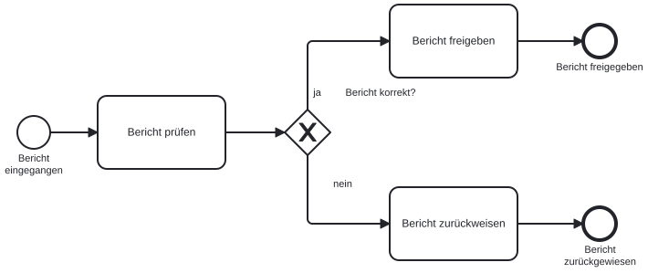


</details>

## 4. Ereignisse: Daten empfangen, warten und reagieren {#bpmn-ereignisse}

### Warten auf Daten und Entscheidungen

Im Data-Science-Lifecycle hängen Datenverständnis, Aufbereitung und Bewertung oft von anderen Personen oder Systemen ab. Daten müssen eintreffen, Rückfragen beantwortet und Analyseergebnisse geprüft werden.

BPMN-Ereignisse zeigen, wann ein Ablauf beginnt, worauf er wartet und wie er auf Unterbrechungen reagiert. Im Beispiel fordert ein Analyseteam einen fehlenden Datenexport bei einem externen Datenanbieter an.

### Start, Zwischenstation und Ende

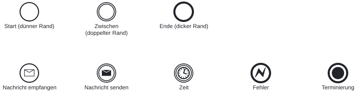

Ein Startereignis hat einen dünnen Kreis. Es beginnt einen neuen Prozessdurchlauf, etwa beim Eingang einer Analyseanfrage.

Ein Zwischenereignis hat einen doppelten Kreis. Es kann während des Ablaufs etwas empfangen oder auslösen.

Ein Endereignis hat einen dicken Kreis. Ein normales Ende beendet den ankommenden Pfad; andere aktive Pfade können weiterlaufen.

### Nachrichten und Zeit


Ein heller Umschlag steht für eine empfangene Nachricht. Ein dunkler Umschlag kennzeichnet eine gesendete Nachricht.

Ein Nachrichten-Startereignis beginnt den Analyseprozess. Ein empfangendes Nachrichten-Zwischenereignis wartet innerhalb eines bereits laufenden Prozesses.

Ein Zeit-Startereignis beginnt den Berichtslauf nach einem Zeitplan. Ein Zeit-Zwischenereignis wartet auf einen Zeitpunkt oder eine Dauer.

Ein Timer prüft keine Datenlieferung. Ein Ablauf mit einem zweitägigen Timer wartet auch dann weiter, wenn die Daten früher eintreffen.

### Das Ereignisdiagramm erkunden


**Start:** Dünner Rand: Eine Analyseanfrage startet einen neuen Prozessdurchlauf.

**Zwischen:** Doppelter Rand: Der laufende Prozess wartet etwa auf eine Datenlieferung.

**Ende:** Dicker Rand: Der freigegebene Bericht schließt einen Prozesspfad ab.

**Nachricht empfangen:** Heller Umschlag: Eine Datenlieferung von einem anderen Teilnehmer trifft ein.

**Nachricht senden:** Dunkler Umschlag: Eine Nachricht geht an einen anderen Teilnehmer.

**Zeit:** Uhr: Ein Zeitpunkt oder eine Dauer bestimmt das Ereignis.

**Fehler:** Blitz: Ein modellierter Fehler im Teilprozess wird an seine Fehlerbehandlung weitergegeben.

**Terminierung:** Gefüllter Kreis: Alle aktiven Pfade im betroffenen Prozessumfang werden beendet.
### Selbstcheck: Ein Ereignis auswählen

Ein täglicher Bericht soll morgens automatisch starten. Welches Ereignis beschreibt diesen Auslöser?

1. Ein empfangendes Nachrichten-Zwischenereignis
2. Ein Zeit-Startereignis
3. Ein normales Endereignis

<details>
<summary>Lösung und Begründung</summary>

- Ein Zeit-Startereignis

Der wiederkehrende Termin beginnt einen neuen Durchlauf. Deshalb ist ein Zeit-Startereignis passend. Ein Zwischenereignis setzt einen bereits gestarteten Prozess voraus.

</details>
### Warten auf das erste Ereignis

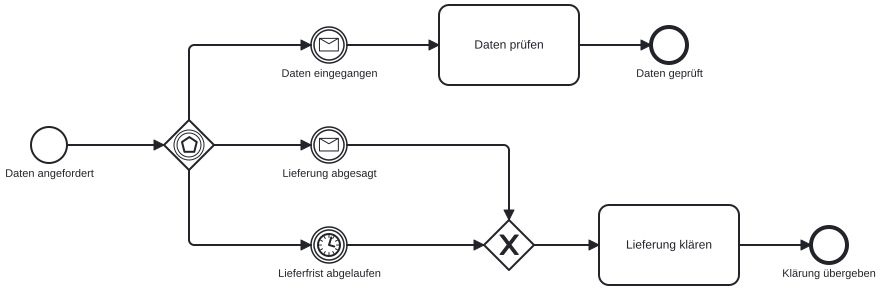

Ein ereignisbasiertes Gateway wartet auf konkurrierende Ereignisse. Das zuerst eintretende Ereignis bestimmt den weiteren Pfad.

Beispiel: Nach der Datenanforderung wartet der Prozess auf „Daten eingegangen“, „Lieferung abgesagt“ oder „Lieferfrist abgelaufen“.

Trifft die Lieferung zuerst ein, wird sie geprüft. Absage oder Fristablauf führen zur Klärung. Die anderen Wartealternativen werden jeweils aufgehoben.

Hinter dem Gateway stehen in diesem Modell empfangende Zwischenereignisse. BPMN erlaubt auch Empfangsaufgaben unter den jeweiligen Modellierungsregeln.

### Vorliegende Daten und künftige Ereignisse


Ein XOR-Gateway verzweigt anhand eines bereits vorliegenden Ergebnisses, etwa nach „Datenqualität prüfen“.

Ein ereignisbasiertes Gateway wartet auf etwas, das noch eintreten muss. Ein XOR direkt nach der Datenanforderung kann eine künftige Antwort nicht vorwegnehmen.

Ein AND würde beide Zweige starten. Eine AND-Zusammenführung würde auf beide Ergebnisse warten und ist deshalb für konkurrierende Wartealternativen ungeeignet.

### Selbstcheck: Eine Wartefalle erkennen

Ein externes Labor soll Messdaten liefern. Der Ablauf soll bei Eingang sofort fortfahren, nach Ablauf der vereinbarten Frist aber eskalieren. Welche Modellierung passt?

1. Zuerst bis zur Frist warten, anschließend die Daten prüfen.
2. Nach der Anforderung ein ereignisbasiertes Gateway mit Datenempfang und Fristablauf einsetzen.
3. Datenempfang und Fristablauf über ein AND starten und beide abwarten.

<details>
<summary>Lösung und Begründung</summary>

- Nach der Anforderung ein ereignisbasiertes Gateway mit Datenempfang und Fristablauf einsetzen.

Die Alternativen konkurrieren. Das erste Ereignis soll den Pfad festlegen. Ein vorgelagerter Timer verzögert frühe Lieferungen; eine AND-Zusammenführung würde beide Ereignisse verlangen.

</details>
### Ereignisse während einer Aufgabe


Ein Randereignis sitzt auf der Grenze einer Aktivität. Es kann nur eintreten, solange diese Aktivität aktiv ist.

Ein durchgezogener Rand unterbricht die Aktivität und führt auf den Ereignispfad. Beispiel: Der Auftrag wird zurückgezogen, während der Bericht geprüft wird.

Ein gestrichelter Rand startet einen zusätzlichen Pfad. Die Aktivität läuft weiter. Beispiel: Während der Berichtsprüfung wird nach einem vereinbarten Zeitraum ein Zwischenstand angefordert.

Eine Erinnerung beendet die Prüfung nicht. Eine Rücknahme kann sie beenden. Diese fachliche Regel muss vor dem Zeichnen feststehen.

### Selbstcheck: Unterbrechen oder weiterarbeiten

An der Aktivität „Bericht prüfen“ gelten die folgenden Regeln. Welche Art Randereignis passt?

Kategorien: Unterbrechend, Nicht unterbrechend.

1. Der Auftrag wird zurückgezogen; die Prüfung soll enden.
2. Ein Zwischenstand wird angefordert; die Prüfung läuft weiter.
3. Die Freigabefrist endet; der Bericht darf danach nicht mehr verwendet werden und die Prüfung endet.
4. Eine Erinnerung geht an die prüfende Person; sie prüft weiter.

<details>
<summary>Lösung und Begründung</summary>

- Der Auftrag wird zurückgezogen; die Prüfung soll enden.: **Unterbrechend**
- Ein Zwischenstand wird angefordert; die Prüfung läuft weiter.: **Nicht unterbrechend**
- Die Freigabefrist endet; der Bericht darf danach nicht mehr verwendet werden und die Prüfung endet.: **Unterbrechend**
- Eine Erinnerung geht an die prüfende Person; sie prüft weiter.: **Nicht unterbrechend**

Maßgeblich ist die ausdrücklich genannte Wirkung auf die laufende Aktivität. Rücknahme und ungültig gewordene Freigabe unterbrechen hier. Zwischenstand und Erinnerung laufen nebenher.

</details>
### Fehler und Terminierung


Ein Fehlerereignis mit Blitz modelliert einen benannten Fehler. Ein Fehler-Endereignis im Teilprozess kann von einem passenden unterbrechenden Fehler-Randereignis abgefangen werden.

Beispiel: „Daten einlesen“ endet mit dem Fehler „Schema nicht unterstützt“. Die Fehlerbehandlung fordert ein geeignetes Format an. Ein fehlender Wert muss dagegen nicht als technischer Fehler modelliert werden.

Ein Terminierungs-Endereignis mit gefülltem Kreis beendet alle aktiven Pfade in seinem Prozessumfang. Innerhalb eines Teilprozesses betrifft es zunächst diesen Teilprozess.

Ein normales Endereignis beendet nur den dort ankommenden Pfad. Für eine vollständige Abbruchlogik müssen auch Teilprozesse und noch aktive Nebenpfade betrachtet werden.

### Übung: Datenlieferung mit Frist modellieren

Beispielfall: Ein externer Datenanbieter erhält eine Anforderung. Die erste Lieferung startet sofort die Datenprüfung. Nach zwei Tagen ohne Lieferung wird der Vorgang zur Klärung übergeben.

Voraussetzung: Zugang zum BPMN-Editor oder Papier und Stift.

1. Ein neues Diagramm mit dem Start „Datenbedarf geklärt“ anlegen.
2. Die Sendeaufgabe „Datenexport anfordern“ ergänzen.
3. Dahinter ein ereignisbasiertes Gateway ergänzen.
4. Eine Alternative mit dem Nachrichten-Zwischenereignis „Daten eingegangen“ verbinden.
5. Dahinter die Aufgabe „Datenqualität prüfen“ ergänzen.
6. Diesen Pfad mit „Datenprüfung abgeschlossen“ beenden.
7. Die zweite Alternative mit dem Zeit-Zwischenereignis „Zwei Tage abgelaufen“ verbinden.
8. Dahinter die Aufgabe „Lieferung klären“ ergänzen.
9. Diesen Pfad mit „Klärung übergeben“ beenden.
10. Die Fälle „Lieferung am ersten Tag“ und „keine Lieferung“ einzeln durchgehen.
11. Das Modell als BPMN-Datei speichern.

Prüfkriterium: Frühe Lieferungen führen ohne zusätzliche Wartezeit zur Prüfung. Ohne Lieferung führt nur der Fristpfad zur Klärung.

[BPMN-Editor öffnen](https://demo.bpmn.io/)

<details>
<summary>Musterlösung</summary>

Nach der Sendeaufgabe folgt das ereignisbasierte Gateway. Es besitzt zwei ausgehende Sequenzflüsse: zum empfangenden Nachrichtenereignis und zum Timer. Beide Zweige enden getrennt. Ein AND-Join ist hier falsch, weil jeweils nur eine Alternative eintritt. Eine Lieferung nach dem Fristablauf gehört zur weiteren Klärung und wird in diesem begrenzten Modell nicht automatisch verarbeitet.

</details>

## 5. Teilnehmer, Daten und Aufgabentypen {#bpmn-teilnehmer-daten}

### Zuständigkeiten im Analyseprozess

Ein Data-Science-Projekt verbindet fachliche Ziele mit Datenverständnis, Aufbereitung, Modellierung, Bewertung und Nutzung. Die Phasen beschreiben, woran gearbeitet wird. BPMN ergänzt, wer welche Aufgabe übernimmt und welche Informationen weitergegeben werden.

Die Rollen bleiben bei einer Rückkehr zur Aufbereitung oder zur fachlichen Frage erkennbar. Ein automatisch erzeugter Codeentwurf und die fachliche Bewertung eines Analysemodells sind dabei unterschiedliche Aufgaben.

### Pools und Lanes

Der Ausschnitt fasst die Analyse zunächst in einer Aufgabe zusammen. Das Fachurteil ist einer eigenen Rolle zugeordnet.

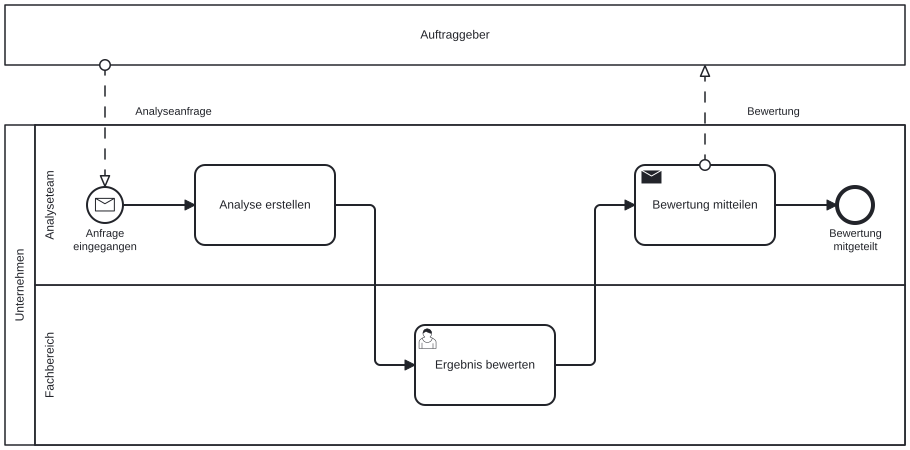

Ein Pool stellt einen Teilnehmer mit eigenem Prozess dar. Ein externer Datenanbieter kann als zugeklappter Pool erscheinen, wenn seine internen Schritte unbekannt sind.

Lanes gliedern einen Prozess nach Rollen, Stellen oder Systemen. Im Pool „Unternehmen“ können „Fachbereich“, „Analyseteam“ und „Analysesystem“ denselben Vorgang bearbeiten.

Der Zuschnitt hängt von der Prozessgrenze ab. Zwei interne Teams brauchen nicht automatisch getrennte Pools.

Eine Lane „Coding-Agent“ benennt die ausführende Komponente. Fachliche Verantwortung und Berechtigungen müssen zusätzlich geklärt werden.

### Phasen und Rollen unterscheiden


Fachliches Verständnis (Business Understanding) klärt die fachliche Entscheidung und das Erfolgskriterium. Fachbereich und Analyseteam arbeiten daran gemeinsam.

Datenverständnis und Datenaufbereitung prüfen Quellen, Qualität und verwendbare Merkmale. Das Analyseteam dokumentiert Änderungen und Annahmen.

Modellierung entwickelt das Analysemodell. Bewertung untersucht seine Eignung für die fachliche Frage und kann zurück zu Daten oder Modellierung führen.

Bereitstellung und Nutzung (Deployment) umfassen die Anwendung des Ergebnisses und dessen Beobachtung. Rückmeldungen können neue Datenarbeit oder eine veränderte Fragestellung auslösen.

CRISP-DM gliedert die zuvor verwendeten Bereiche Plan, Data, Model und Deployment genauer in sechs Phasen. Diese Phasen sind keine Lanes: Eine Rolle kann in mehreren Phasen arbeiten, eine Phase mehrere Rollen benötigen.

### Verbindungen zwischen Beteiligten


Ein Sequenzfluss bestimmt die Reihenfolge innerhalb eines Pools. Er darf Lane-Grenzen überqueren, aber keine Pool-Grenze.

Ein Nachrichtenfluss verbindet unterschiedliche Pools. Er nennt die übertragene Nachricht, etwa „Datenanforderung“ oder „Datenlieferung“.

Zwischen Fachbereich und Analyseteam im selben Pool werden Aufgaben durch Sequenzflüsse verbunden. Zum externen Datenanbieter werden Nachrichtenflüsse verwendet.

Ein zugeklappter Pool kann Nachrichten am Poolrand empfangen oder senden. Im offenen Pool werden geeignete Sende- oder Empfangselemente verbunden.

### Selbstcheck: Prozessgrenzen zuordnen

Der Pool „Unternehmen“ umfasst einen gemeinsam gesteuerten Berichtsprozess. Externe Stellen haben eigene Abläufe. Welche Zuordnung passt?

Kategorien: Lane im Unternehmenspool, Separater Pool.

1. Das interne Analyseteam prüft die Daten im gemeinsamen Berichtsprozess.
2. Ein externer Anbieter bearbeitet Datenanforderungen in seinem eigenen System.
3. Der interne Fachbereich gibt denselben Bericht frei.
4. Ein externer Kunde erhält den Bericht; sein weiterer Umgang damit bleibt außerhalb des Modells.

<details>
<summary>Lösung und Begründung</summary>

- Das interne Analyseteam prüft die Daten im gemeinsamen Berichtsprozess.: **Lane im Unternehmenspool**
- Ein externer Anbieter bearbeitet Datenanforderungen in seinem eigenen System.: **Separater Pool**
- Der interne Fachbereich gibt denselben Bericht frei.: **Lane im Unternehmenspool**
- Ein externer Kunde erhält den Bericht; sein weiterer Umgang damit bleibt außerhalb des Modells.: **Separater Pool**

Analyseteam und Fachbereich sind hier Teil des gemeinsam modellierten Prozesses. Anbieter und Kunde werden als Teilnehmer mit eigenen Prozessen betrachtet. Die Prozessgrenze ist entscheidend, nicht allein die Abteilungsbezeichnung.

</details>
### Datenobjekt und Datenspeicher

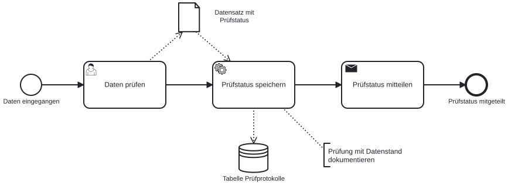

Ein Datenobjekt beschreibt Information eines Prozessdurchlaufs. Beispiel: „Datenexport April“ wird von „Datenqualität prüfen“ verwendet.

Ein Datenspeicher bleibt über den einzelnen Durchlauf hinaus bestehen. Beispiel: Ein Data Warehouse liefert Daten für mehrere Berichte.

Datenassoziationen zeigen, welche Informationen eine Aktivität liest oder erzeugt. Sie bestimmen keine Ausführungsreihenfolge.

Ein Python-System kann Aufgaben ausführen und deshalb als Lane erscheinen. Seine dauerhafte Ergebnisablage ist ein Datenspeicher. Beide Darstellungen erfüllen unterschiedliche Zwecke.

### Fachliche Regeln dokumentieren


Eine Textanmerkung ergänzt eine Regel oder Annahme, etwa „Nur freigegebene Datenquellen verwenden“.

Die Assoziation einer Anmerkung steuert keinen Ablauf. Eine erforderliche Prüfung braucht eine Aktivität und gegebenenfalls eine Verzweigung.

Dateiformat, Version und Prüfkriterium können in der Dokumentation einer Aufgabe stehen. Ein Modell allein erzwingt diese Regeln nicht.

### Selbstcheck: Verbindungen prüfen

Welche Zeile verletzt die Verbindungsregeln des beschriebenen Modells?

1. Analyseteam und Fachbereich liegen als Lanes im Pool Unternehmen.
2. Ein Sequenzfluss verbindet Datenqualität prüfen und Bericht freigeben über die Lane-Grenze hinweg.
3. Der externe Anbieter sendet die Datenlieferung per Nachrichtenfluss an die Empfangsaufgabe des Unternehmens.
4. Die Aufgabe Datenexport anfordern ist per Sequenzfluss mit dem separaten Anbieter-Pool verbunden.

<details>
<summary>Lösung und Begründung</summary>

- Die Aufgabe Datenexport anfordern ist per Sequenzfluss mit dem separaten Anbieter-Pool verbunden.

Ein Sequenzfluss darf die Pool-Grenze nicht überschreiten. Die Datenanforderung braucht einen Nachrichtenfluss zum Anbieter. Innerhalb des Unternehmens darf der Sequenzfluss dagegen zwischen Lanes verlaufen.

</details>
### Aufgabentypen

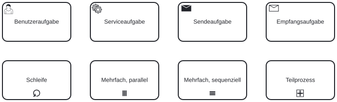

Eine Benutzeraufgabe beschreibt menschliche Arbeit mit IT-Unterstützung, etwa „Bericht fachlich freigeben“. Eine manuelle Aufgabe benötigt keine solche IT-Unterstützung.

Eine Serviceaufgabe verwendet einen Dienst oder eine automatisierte Anwendung. Beispiele sind ein Aufruf des Analysesystems oder eines KI-Dienstes.

Eine Skriptaufgabe wird durch die ausführende Prozessumgebung als Skript ausgeführt. Ein beliebiges Python-Notebook ist deshalb nicht automatisch eine BPMN-Skriptaufgabe.

Eine Geschäftsregelaufgabe ruft eine Regelentscheidung auf. Die Raute des Gateways selbst führt keine Regelprüfung aus.

### Senden und Empfangen


Eine Sendeaufgabe verschickt eine Nachricht an einen anderen Teilnehmer. Beispiel: „Datenexport anfordern“ sendet die Anforderung an den Anbieter.

Eine Empfangsaufgabe wartet auf eine Nachricht eines anderen Teilnehmers. Beispiel: „Datenlieferung empfangen“.

Der Sendeaufgabentyp legt nicht fest, ob ein Mensch zuvor zustimmen muss. Eine erforderliche Freigabe wird als eigene Benutzeraufgabe modelliert.

Ein KI-Aufruf besitzt keinen eigenen BPMN-Aufgabentyp. Ein automatisierter Aufruf kann als Serviceaufgabe mit passender Dokumentation modelliert werden.

### Selbstcheck: Aufgaben unterscheiden

Welche Darstellung passt zu den ausdrücklich beschriebenen Tätigkeiten?

Kategorien: Benutzeraufgabe, Serviceaufgabe, Empfangsaufgabe, Sendeaufgabe.

1. Eine Analystin beurteilt den Bericht in einer Prüfoberfläche.
2. Ein automatisierter Dienst berechnet aus geprüften Daten die Kennzahlen.
3. Der Prozess wartet auf die zugesagte Lieferung eines externen Datenanbieters.
4. Der freigegebene Bericht wird an den externen Auftraggeber übermittelt.

<details>
<summary>Lösung und Begründung</summary>

- Eine Analystin beurteilt den Bericht in einer Prüfoberfläche.: **Benutzeraufgabe**
- Ein automatisierter Dienst berechnet aus geprüften Daten die Kennzahlen.: **Serviceaufgabe**
- Der Prozess wartet auf die zugesagte Lieferung eines externen Datenanbieters.: **Empfangsaufgabe**
- Der freigegebene Bericht wird an den externen Auftraggeber übermittelt.: **Sendeaufgabe**

Die Benutzeraufgabe beschreibt die fachliche Beurteilung durch einen Menschen. Berechnung durch einen Dienst ist eine Serviceaufgabe. Warten auf eine externe Nachricht und deren Versand haben eigene Aufgabentypen.

</details>
### Wiederholungen


Eine Standardschleife wiederholt eine Aktivität abhängig von einer Bedingung. Beispiel: Einen Bericht überarbeiten, solange die Prüfung konkrete Änderungsbedarfe meldet.

Eine parallele Mehrfachinstanz, erkennbar an drei senkrechten Strichen, startet eine Instanz je Element einer Sammlung. Beispiel: Unabhängige Datenlieferungen prüfen.

Eine sequenzielle Mehrfachinstanz mit drei waagerechten Strichen verarbeitet die Elemente nacheinander. Beispiel: Lieferungen einzeln in eine nur seriell beschreibbare Ablage übernehmen.

Mehrfachinstanzen beziehen sich auf eine Sammlung. Die Standardschleife wiederholt dieselbe Aktivität nach einer Bedingung. Parallelität im Modell garantiert keine bestimmte Rechenleistung.

### Selbstcheck: Ein Marker auswählen

Fünf Datenquellen sind bekannt. Für jede Quelle wird dieselbe Prüfung ausgeführt. Die Prüfungen sind unabhängig und dürfen gleichzeitig laufen. Welcher Marker passt?

1. Standardschleife
2. Parallele Mehrfachinstanz
3. Sequenzielle Mehrfachinstanz

<details>
<summary>Lösung und Begründung</summary>

- Parallele Mehrfachinstanz

Die bekannte Sammlung bestimmt die Zahl der Instanzen. Die Prüfungen dürfen unabhängig gleichzeitig laufen, daher passt die parallele Mehrfachinstanz. Eine Standardschleife würde anhand einer Bedingung wiederholen.

</details>
### Teilprozesse


Ein zugeklappter Teilprozess bündelt mehrere Aktivitäten. Das Plus im Kästchen zeigt, dass Details vorhanden sind.

Beispiel: „Datenquelle prüfen“ enthält „Schema prüfen“, „Fehlende Werte untersuchen“ und „Verwendbarkeit beurteilen“.

Aufgeklappt erscheinen die internen Aktivitäten im Teilprozess. Ein eigener Start und ein eigenes Ende zeigen den internen Ablauf. Die Ein- und Ausgänge des übergeordneten Ablaufs bleiben erhalten.

Sequenzflüsse überschreiten keine Teilprozessgrenze. Der übergeordnete Ablauf verbindet sich mit der Teilprozessaktivität. Eine Aufrufaktivität verweist dagegen auf einen separat definierten, wiederverwendbaren Prozess.

### Übung: Datenlieferung und Berichtprüfung zuordnen

Beispielfall: Ein externer Anbieter liefert einen Export. Das Analyseteam prüft ihn. Ein Analysedienst berechnet Kennzahlen. Der Fachbereich prüft den Bericht. Bei Ablehnung wird er überarbeitet und erneut geprüft.

Voraussetzung: Zugang zum BPMN-Editor oder Papier und Stift.

1. Für Unternehmen und Datenanbieter je einen Pool anlegen.
2. Den Anbieter-Pool zuklappen.
3. Im Unternehmenspool die Lanes „Analyseteam“, „Analysesystem“ und „Fachbereich“ anlegen.
4. Den Eingang der Datenlieferung als Nachrichten-Startereignis modellieren.
5. Die Aufgaben aus dem Fall den Lanes zuordnen.
6. Die Aufgaben durch Sequenzflüsse verbinden.
7. Die Freigabeentscheidung nach der Berichtsprüfung als XOR modellieren.
8. Den Ablehnungspfad zur Überarbeitung zurückführen.
9. Den Freigabepfad mit „Bericht freigegeben“ beenden.
10. Den Datenexport als Datenobjekt ergänzen.
11. Die dauerhafte Ergebnisablage als Datenspeicher ergänzen.
12. Die benötigten Datenassoziationen ergänzen.
13. Die Nachricht „Datenlieferung“ zwischen den Pools ergänzen.
14. Das Modell als BPMN-Datei speichern.

Prüfkriterium: Die Pool-Grenze wird nur vom Nachrichtenfluss überquert. Die Ablehnung führt über Überarbeitung zu erneuter Prüfung.

[BPMN-Editor öffnen](https://demo.bpmn.io/)

<details>
<summary>Musterlösung</summary>

Der Anbieter sendet an den Nachrichten-Start im Unternehmen. Die Datenprüfung liegt beim Analyseteam, die Berechnung beim Analysesystem und die Freigabeprüfung beim Fachbereich. Das XOR verwendet das Prüfergebnis. Bei nein folgt Bericht überarbeiten und die erneute Prüfung; bei ja endet der Prozess. Das Datenobjekt beschreibt die konkrete Lieferung, der Datenspeicher die dauerhafte Ablage.

</details>

## 6. Vom Data-Science-Lifecycle zum Analyseworkflow {#bpmn-analyseworkflow}

### Vom Modell zur ausführbaren Analyse

Der Data-Science-Lifecycle beschreibt den Weg von einer fachlichen Frage bis zur Nutzung einer Analyse. CRISP-DM unterscheidet sechs Phasen: Fachliches Verständnis (Business Understanding), Datenverständnis, Datenaufbereitung, Modellierung, Bewertung sowie Bereitstellung und Nutzung (Deployment).

Ein BPMN-Modell macht daraus konkrete Aufgaben mit Zuständigkeiten und Rückwegen. Die Bewertung kann zur Modellierung, zur Datenaufbereitung oder zur fachlichen Frage zurückführen. Nach der Nutzung liefern Beobachtungen neue Anforderungen.

### Analysemodell, KI-Modell und Prozessmodell


Ein Analysemodell, etwa eine Regression, beschreibt Zusammenhänge oder erzeugt Vorhersagen. Es wird mit geeigneten Daten und fachlichen Kriterien bewertet.

Ein generatives KI-Modell kann Code oder Erklärungen entwerfen. Diese Unterstützung ist nicht mit dem Analysemodell gleichzusetzen.

Ein BPMN-Modell beschreibt den Arbeitsablauf. Seine Qualität beweist weder die Güte einer Vorhersage noch die Richtigkeit des erzeugten Codes.

### Aufgaben konkret zuordnen


Fachliches Verständnis (Business Understanding): Die Fachperson klärt die Entscheidung und das Erfolgskriterium. Das Analyseteam prüft, welche Daten und Methoden dazu passen.

Datenverständnis und Aufbereitung: Quellen, Qualität, Merkmale und notwendige Änderungen werden geprüft und dokumentiert.

Modellierung: Ein Coding-Agent kann Code für eine Regression vorbereiten. Der gespeicherte, geprüfte Python-Code trainiert und testet das Analysemodell.

Bewertung: Das Analyseteam prüft Modellleistung und Grenzen; der Fachbereich beurteilt den Nutzen für die Entscheidung.

Bereitstellung und Nutzung (Deployment): Eine zuständige Person entscheidet über die Verwendung. Beobachtungen aus dem Betrieb werden an die fachliche Frage zurückgegeben.

### Rückwege fachlich begründen


Ein unzureichendes Ergebnis verlangt zuerst eine Ursachenprüfung. Ein Gateway kann anschließend anhand des festgestellten Grundes verzweigen.

Ungeeignete oder fehlerhafte Merkmale führen zurück zur Datenaufbereitung. Fehlende Informationen können zusätzliche Datenbeschaffung erfordern.

Ein ungeeignetes Modellverfahren führt zurück zur Modellierung. Eine veränderte fachliche Anforderung führt zurück zum fachlichen Verständnis.

Nach der Nutzung werden Datenqualität, Ergebnisqualität und fachlicher Nutzen weiter beobachtet. Abweichungen lösen eine erneute Bewertung aus.

Welche Abweichung eine Überarbeitung auslöst, wird fachlich festgelegt. Ein KI-Entwurf darf solche Grenzwerte nicht selbst erfinden.

### Eingaben, Ergebnisse und Fehlerpfade


Jede automatisierte Aufgabe braucht definierte Eingaben und ein prüfbares Ergebnis. Beispiel: Eine CSV-Datei mit festgelegten Spalten wird zu einer Tabelle mit Kennzahlen.

Eine Datenprüfung kann ein maschinenlesbares Prüfergebnis liefern. Ein XOR verwendet dieses Ergebnis für „geeignet“ oder „Klärung erforderlich“.

Bei fehlenden Spalten wird die Berechnung angehalten. Der Fehlerpfad benennt die fehlende Voraussetzung und führt zu einer verantwortlichen Person.

Ein Diagramm begrenzt keine Dateizugriffe. Projektregeln, technische Berechtigungen und die Prüfung tatsächlicher Änderungen ergänzen das Modell.

### Selbstcheck: Modell und Umsetzung zuordnen

Welche Umsetzung gehört zur jeweiligen fachlichen Aufgabe?

**Aufgaben**

1. Analysecode entwerfen
2. Kennzahlen wiederholt berechnen
3. Ergebnis fachlich freigeben
4. Datenstand und Bericht aufbewahren

**Umsetzungen**

1. Versionierte oder eindeutig bezeichnete Ablage
2. Dokumentierte Entscheidung der verantwortlichen Fachperson
3. Gespeichertes Python-Skript mit festgelegter Umgebung
4. Begrenzter Coding-Agent-Auftrag mit anschließendem Code-Review

<details>
<summary>Lösung und Begründung</summary>

- Analysecode entwerfen: Begrenzter Coding-Agent-Auftrag mit anschließendem Code-Review
- Kennzahlen wiederholt berechnen: Gespeichertes Python-Skript mit festgelegter Umgebung
- Ergebnis fachlich freigeben: Dokumentierte Entscheidung der verantwortlichen Fachperson
- Datenstand und Bericht aufbewahren: Versionierte oder eindeutig bezeichnete Ablage

Der Agent unterstützt beim Entwurf. Die Wiederholung verwendet den gespeicherten und geprüften Code. Fachliche Freigabe und nachvollziehbare Ablage sind eigenständige Aufgaben.

</details>
### Verzweigungen und Wartezustände umsetzen


Ein XOR lässt sich beispielsweise durch eine geprüfte if-Bedingung umsetzen. Alle fachlich möglichen Ergebnisse brauchen einen definierten Pfad.

Ein AND verlangt, dass alle benötigten Zweige ihre Ergebnisse liefern. Die technische Umsetzung muss Abhängigkeiten, Fehler und das Zusammenführen der Ergebnisse behandeln.

Eine menschliche Freigabe braucht einen persistenten Status und einen geregelten Wiedereinstieg. Ein kurz angehaltenes Notebook bildet keinen verlässlichen Freigabeprozess.

Timer und Nachrichtenempfang benötigen geeignete Ausführungskomponenten. Ein BPMN-Diagramm oder eine einzelne Python-Datei stellt diese Komponenten nicht automatisch bereit.

### Selbstcheck: Eine automatische Freigabe erkennen

Ein KI-Entwurf berechnet Kennzahlen, schreibt einen Bericht und sendet ihn direkt an die Geschäftsführung. Das bestätigte Modell verlangt davor eine fachliche Freigabe. Was fehlt?

1. Eine freundlichere Formulierung des Berichts.
2. Ein zusätzlicher Modellaufruf, der sich selbst kontrolliert.
3. Ein technisch wirksamer Halt vor dem Versand und eine dokumentierte Entscheidung der zuständigen Person.

<details>
<summary>Lösung und Begründung</summary>

- Ein technisch wirksamer Halt vor dem Versand und eine dokumentierte Entscheidung der zuständigen Person.

Die Freigabe muss im ausgeführten Ablauf wirksam sein. Ein zusätzlicher Modellaufruf ersetzt die Entscheidung der zuständigen Person nicht. Der Versand darf bei ausstehender oder verweigerter Freigabe nicht weiterlaufen.

</details>
### Ist-Prozess und neuer Ablauf


Ein Ist-Modell beschreibt den tatsächlichen Ablauf einschließlich manueller Übergaben. Ein Soll-Modell beschreibt einen begründeten Vorschlag für die künftige Arbeit.

Beim Einsatz von KI können Schritte entfallen, ergänzt oder anders zugeordnet werden. Jede Änderung braucht eine fachliche Begründung.

Eine Zeitersparnis ist zunächst eine Annahme. Ein Pilot kann etwa Bearbeitungszeit, Nacharbeit und Fehler untersuchen.

Die Modellierung macht den eigenen Beitrag sichtbar: Fragestellung, Qualitätskriterien und Freigabe brauchen festgelegte Zuständigkeiten.

### Einen KI-Entwurf prüfen


Der Entwurf muss die beschriebenen Aufgaben und Prozessgrenzen wiedergeben. Ergänzte Aufgaben werden als Vorschlag kenntlich gemacht.

Gateway-Ausgänge brauchen eindeutige Bedingungen. Vor einer datenbasierten Entscheidung muss das benötigte Ergebnis vorliegen.

Jeder Pfad braucht ein fachliches Ergebnis. Rückwege, Fristen und Abbrüche müssen zusammenpassen.

Aufgaben werden Rollen oder Systemen zugeordnet. Die benötigten Daten und die Ergebnisse jeder Übergabe werden benannt.

### Selbstcheck: Eine unbelegte Ergänzung beurteilen

Die Prozessbeschreibung nennt keine Frist für die Berichtfreigabe. Ein KI-Entwurf setzt nach einem Tag automatisch die Freigabe und versendet den Bericht. Wie wird der Entwurf korrigiert?

1. Die Frist verlängern; automatische Freigaben sind grundsätzlich unproblematisch.
2. Frist und Entscheidung bei ausbleibender Freigabe fachlich klären; bis dahin keine automatische Freigabe modellieren.
3. Den Timer in ein AND-Gateway ändern.

<details>
<summary>Lösung und Begründung</summary>

- Frist und Entscheidung bei ausbleibender Freigabe fachlich klären; bis dahin keine automatische Freigabe modellieren.

Der Entwurf erfindet sowohl eine Frist als auch eine Freigaberegel. Beides beeinflusst die tatsächliche Verantwortung und muss geklärt werden. Eine andere Gateway-Art löst das Problem nicht.

</details>
### Übung: Eigenen Analyseprozess gestalten

Voraussetzungen: Ein Analysevorhaben aus dem eigenen Arbeitsumfeld und Zugang zum BPMN-Editor. Alternativ dient der folgende Fall.

Beispielfall: Ein Fachbereich benötigt eine Nachfrageprognose für seine Planung. Das Analyseteam klärt Entscheidung und Erfolgskriterium, untersucht die verfügbaren Daten und bereitet sie auf. Es entwickelt und bewertet ein Prognosemodell. Bei unzureichenden Ergebnissen wird die Ursache untersucht. Datenprobleme führen zur Aufbereitung, ein ungeeignetes Verfahren zur Modellierung, eine veränderte Anforderung zur fachlichen Frage zurück. Eine zuständige Person entscheidet über die Nutzung. Im Einsatz werden Ergebnisqualität und fachlicher Nutzen beobachtet. Auffälligkeiten lösen eine erneute Bewertung aus.

Datenschutz: Nur freigegebene, anonymisierte Prozessbeschreibungen in ein KI-Werkzeug eingeben.

1. Die fachliche Frage und die beabsichtigte Nutzung notieren.
2. Die sechs CRISP-DM-Phasen passenden Aufgaben zuordnen.
3. Die Aufgaben im BPMN-Editor zeichnen.
4. Für jede Aufgabe die verantwortliche Rolle benennen.
5. Die benötigten Daten und Ergebnisse an den Übergaben ergänzen.
6. Nach der Bewertung die Entscheidung über die Eignung modellieren.
7. Nur im unzureichenden Pfad die Ursachenprüfung ergänzen.
8. Die Rückwege zur Aufbereitung, Modellierung und fachlichen Klärung modellieren.
9. Die menschliche Entscheidung vor der Nutzung ergänzen.
10. Die Beobachtung nach der Nutzung modellieren.
11. Einen Rückweg von auffälligen Beobachtungen zur Bewertung ergänzen.
12. Einen unterstützenden Coding-Agenten einer geeigneten Aufgabe zuordnen.
13. Die Fälle Datenproblem, ungeeignetes Verfahren und veränderte Fachfrage einzeln durchgehen.
14. Das Modell als BPMN-Datei speichern.
15. Das Modell zusätzlich als SVG exportieren.

Prüfkriterium: Alle sechs Phasen sind zugeordnet. Die Rückwege passen zur Ursache. Vor der Nutzung entscheidet eine verantwortliche Person.

[BPMN-Editor öffnen](https://demo.bpmn.io/)

<details>
<summary>Musterlösung</summary>

Die Phasen werden als Aufgaben oder Teilprozesse modelliert, nicht als Lanes. Nach Bewertung und gegebenenfalls Ursachenprüfung verzweigt der Ablauf anhand des Befunds. Rückwege führen zur Datenaufbereitung, Modellierung oder fachlichen Klärung. Vor der Nutzung steht eine menschliche Entscheidung. Im Einsatz beobachtet eine Aufgabe die Qualität und den fachlichen Nutzen; bei Auffälligkeiten folgt eine erneute Bewertung. Ein Coding-Agent unterstützt beim Codeentwurf. Er ersetzt weder das statistische Analysemodell noch die fachliche Nutzungsentscheidung.

</details>

### Übung: Den Modellentwurf mit KI prüfen

Voraussetzung: Eine anonymisierte Prozessbeschreibung und ein freigegebenes Chat-Werkzeug.

1. Die eigene Beschreibung in den folgenden Auftrag einsetzen.
2. Den Auftrag im Chat-Werkzeug ausführen.
3. Die offenen Fragen fachlich beantworten.
4. Den überarbeiteten Entwurf mit dem eigenen Modell vergleichen.
5. Nur begründete Änderungen übernehmen.

Prüfkriterium: Jede übernommene Änderung ist fachlich erklärt. Ausstehende Entscheidungen bleiben als offen gekennzeichnet.

```text
Kontext: Hier steht die anonymisierte Beschreibung meines Analyseprozesses: [Beschreibung]. Mein Ist-Modell enthält: [Aufgaben, Rollen, Verbindungen].

Aufgabe: Prüfe den Entwurf fachlich und nach BPMN 2.0.2. Unterscheide bestätigten Ist-Ablauf und Vorschläge für einen Soll-Ablauf mit KI-Unterstützung.

Format: Eine Tabelle mit Element, Befund, Begründung und Änderungsvorschlag. Danach offene Fragen als Liste.

Prüfung: Erfinde keine Fristen, Freigaberegeln oder Zuständigkeiten. Prüfe Pool-Grenzen, Gateway-Bedingungen, Rückwege, Datenübergaben und die Wirkung ausstehender Freigaben. Kennzeichne Unsicherheit ausdrücklich.
```

## 7. Übung: Den Data-Science-Lifecycle modellieren {#bpmn-analyseauftrag}

### Von der Fachfrage zur begründeten Nutzung

Ein Prozessmodell zeigt, wie eine fachliche Frage zu einer geprüften Vorhersage führt. Es macht die Arbeitsteilung sichtbar: Daten verstehen, Daten aufbereiten, ein Modell entwickeln, das Ergebnis bewerten und seine Nutzung festlegen.

**Übungsfall:** Ein externer Auftraggeber möchte die durchschnittliche monatliche Bearbeitungsdauer an drei Standorten vorhersagen. Die Prognosen sollen zunächst einen Pilotbericht für die Personalplanung ergänzen. Ein Analyseservice übernimmt den Auftrag. Die folgenden Regeln und Fristen gelten ausschließlich für diese Übung.

### Auftrag und Zuständigkeiten


Der Auftraggeber sendet Frage, Planungszweck, Datenspezifikation und drei freigegebene CSV-Dateien. Jede Datei enthält monatliche Bearbeitungszeiten eines Standorts. Die Spezifikation legt erforderliche Spalten und Monatsformat fest.

Im Analyseservice arbeiten drei Rollen zusammen: Die Analystin oder der Analyst bearbeitet den Auftrag. Das Analysesystem führt automatisierte Schritte aus. Die Analyseleitung entscheidet über die fachliche Eignung und Freigabe.

Die Analystin oder der Analyst hält Frage und Bewertungskriterien im Auftragsblatt fest. Trainingszeitraum und zeitlich späterer Validierungszeitraum werden vor der Modellierung bestimmt und danach beibehalten.

Als Referenz dient der Mittelwert des Trainingszeitraums je Standort. Das Modell muss im Validierungszeitraum einen geringeren mittleren absoluten Fehler als diese Referenz erzielen. Die Analyseleitung prüft zusätzlich Annahmen und Grenzen für die geplante Pilotnutzung.

### Dateien prüfen und Korrekturen anfordern


Das Analysesystem prüft alle drei Dateien unabhängig voneinander. Pro Datei prüft es gleichzeitig die erforderlichen Spalten und das Monatsformat. Beide Prüfungen liefern jeweils bestanden oder nicht bestanden; anschließend entsteht ein gemeinsamer Prüfvermerk für diese Datei.

Erst nach Abschluss aller drei Dateiprüfungen wird weitergearbeitet. Sind alle sechs Einzelprüfungen bestanden, beginnt die Analyse. Andernfalls sendet die Analystin oder der Analyst die Fehlerliste mit einer Korrekturanforderung an den Auftraggeber.

Nach jeder Korrekturanforderung wartet der Analyseservice höchstens fünf Kalendertage. Trifft vorher ein vollständiges Ersatzpaket mit drei Dateien ein, werden alle Dateien erneut geprüft. Andernfalls informiert die Analystin oder der Analyst über die Schließung; der Auftrag endet ohne Bericht.

Die Frist beginnt mit jeder Korrekturanforderung neu. Nach einer Schließung eintreffende Pakete werden in dieser Prozessinstanz nicht mehr verarbeitet. Eine neue Anfrage startet einen neuen Auftrag.

### Datenaufbereitung, Modellierung und Bewertung


Nach erfolgreicher technischer Prüfung untersucht die Analystin oder der Analyst Bedeutung, Verteilungen und fehlende Werte. Die Person erstellt daraus eine begründete Aufbereitung für Training und Validierung. Technisch lesbare Daten gelten dadurch noch nicht als fachlich geeignet.

Das Analysesystem lässt einen Coding-Agenten Python-Code für Modell und Referenzprognose entwerfen. Die Analystin oder der Analyst prüft und korrigiert den Code vor der Ausführung. Alle Verarbeitungsschritte werden ausschließlich mit den Trainingsdaten angepasst.

Das Analysesystem trainiert das statistische Modell und berechnet beide Prognosen samt Fehlern für den späteren Validierungszeitraum. Die Analyseleitung prüft Fehlervergleich, Annahmen und Grenzen. Sie entscheidet, ob das Ergebnis für den Pilotbericht geeignet ist.

Bei fehlender Eignung beurteilt die Analystin oder der Analyst eine weitere Überarbeitung. Bei einer begründeten Verbesserungsmöglichkeit werden die Hinweise dokumentiert; der Ablauf kehrt zum Datenverständnis und zur Aufbereitung zurück. Andernfalls informiert die Person über den begründeten Abbruch; es wird kein Pilotbericht freigegeben.

### Freigabe und Nutzung


Bei fachlicher Eignung erstellt die Analystin oder der Analyst den Pilotbericht aus den geprüften Ergebnissen. Der Bericht enthält Prognose, Referenzvergleich und Grenzen. Die Freigabe erlaubt ausschließlich diese Pilotnutzung, keine automatische Personalentscheidung.

Anschließend versendet die Analystin oder der Analyst den Pilotbericht. Gleichzeitig archiviert das Analysesystem Datenstand, geprüften Code, Modell und Bewertungsnotiz. Der Auftrag endet nach beiden Schritten.

Wiederholte Modellanpassungen nutzen denselben Validierungszeitraum. Dieser ist deshalb kein unabhängiger Abschlusstest. Der Bericht nennt diese Grenze. Im anschließenden Pilotbetrieb werden neue Prognosen mit den später eintretenden Werten verglichen; dieser Folgeprozess gehört nicht zum hier modellierten Auftrag.

### Daten und technische Annahmen


Auftragsblatt, Datenpaket, Prüfvermerke, Modellcode, Vorhersagen und Bewertungsnotiz sind Informationen im Ablauf. Das Projektarchiv bewahrt den freigegebenen Arbeitsstand auf.

Im Übungsfall gelingen Nachrichtenversand und Systemaufrufe technisch. Die Prüfungen liefern jeweils ein Ergebnis; ein zusätzlicher technischer Ausfallpfad gehört nicht zum Fall.

Der Coding-Agent erzeugt Code. Das statistische Modell berechnet Vorhersagen aus Daten. Das BPMN-Modell beschreibt ihren Einsatz im Arbeitsablauf und richtet weder Werkzeuge noch Zugriffsrechte ein.

### Übung: Den Gesamtprozess zeichnen

Voraussetzungen: Fallbeschreibung aus dieser Lektion und Zugang zu demo.bpmn.io oder Papier und Stift.

1. Für Auftraggeber und Analyseservice je einen Pool anlegen.
2. Den Auftraggeber-Pool zugeklappt lassen.
3. Im Analyseservice die drei beschriebenen Rollen als Lanes ergänzen.
4. Den Eingang des Auftrags modellieren.
5. Die Aufgaben bis zum Ende des Prozesses ergänzen.
6. Jeder Aufgabe einen passenden Aufgabentyp zuordnen.
7. Datenprüfung, Korrekturanforderung und Frist in einem zugeklappten Teilprozess zusammenfassen.
8. Diesen Teilprozess auf einer zweiten Seite detaillieren.
9. Darin die Dateiprüfung mit parallelem Mehrfach-Marker für drei Dateien modellieren.
10. Entscheidungen und Rückwege im Hauptprozess ergänzen.
11. Versand und Archivierung nach der Freigabe modellieren.
12. Nachrichtenflüsse zwischen den Pools ergänzen.
13. Jeder Aufgabe ihre Ein- und Ausgaben zuordnen.
14. Das Projektarchiv als Datenspeicher ergänzen.

Prüfkriterium: Der Kontrollfluss enthält Erfolg, Korrekturschleifen und beide Abbrüche ohne Pilotbericht. Die Datenzuordnung steht im Diagramm oder einer Begleittabelle.

[BPMN-Editor öffnen](https://demo.bpmn.io/)

### Übung: Die Dateiprüfung detaillieren

Voraussetzung: Datenbereitstellungsmodell mit dem Teilprozess „Datei technisch prüfen“.

1. Die innere Struktur des Teilprozesses auf einer dritten Seite zeichnen.
2. Den Beginn einer einzelnen Dateiprüfung modellieren.
3. Die beiden unabhängigen Prüfungen ergänzen.
4. Deren gleichzeitigen Beginn modellieren.
5. Die Prüfungen vor dem gemeinsamen Prüfvermerk zusammenführen.
6. Die Erstellung des Prüfvermerks ergänzen.
7. Das Ende der einzelnen Dateiprüfung ergänzen.
8. „eine Instanz je Datei“ am Teilprozess des Datenbereitstellungsmodells notieren.

Prüfkriterium: Jeder Prüfvermerk enthält beide Prüfergebnisse genau einer Datei. Drei Teilprozessinstanzen liefern insgesamt drei Prüfvermerke.

### Übung: Das Modell durchgehen und sichern

Voraussetzungen: Gesamtmodell, Datenbereitstellung und detaillierte Dateiprüfung.

1. Den Ablauf mit verwendbaren Daten und fachlich geeignetem Modell verfolgen.
2. Den Ablauf mit einer mangelhaften Datei und rechtzeitigem Ersatzpaket verfolgen.
3. Den Ablauf ohne Ersatzpaket innerhalb der Frist verfolgen.
4. Den Ablauf mit einem ungeeigneten Modell und begründeter Überarbeitung verfolgen.
5. Den Ablauf mit einem ungeeigneten Modell und begründetem Abbruch verfolgen.
6. Bei jedem Fall prüfen, welche Aufgaben erneut ausgeführt werden.
7. Prüfen, ob Sequenzflüsse innerhalb ihres Pools bleiben.
8. Prüfen, ob Nachrichtenflüsse ausschließlich die beiden Pools verbinden.
9. Prüfen, ob alle Entscheidungsausgänge eindeutig beschriftet sind.
10. Einen Papierentwurf für den Export in demo.bpmn.io nachzeichnen.
11. Das Gesamtmodell als BPMN-Datei herunterladen.
12. Das Gesamtmodell als SVG herunterladen.
13. Beide Detailmodelle ebenfalls als BPMN-Datei und SVG sichern.

Prüfkriterium: Alle fünf Fälle sind nachvollziehbar. Ein Pilotbericht wird nur nach fachlicher Freigabe versendet.

[BPMN-Editor öffnen](https://demo.bpmn.io/)

<details>
<summary>Musterlösung: Gesamtprozess</summary>

**Kontrollflussübersicht:** Das Diagramm und seine BPMN-Datei zeigen nur ausgewählte Datenassoziationen. Die vollständige Zuordnung der Ein- und Ausgaben steht in den Absätzen unter „Datenzuordnung“. Die beiden Detaildiagramme ergänzen die Datenbereitstellung und die Dateiprüfung.

Eine mögliche Lösung verwendet den zugeklappten Pool „Auftraggeber“ und den Pool „Analyseservice“. Dessen Lanes heißen „Analystin oder Analyst“, „Analysesystem“ und „Analyseleitung“.

**Fachfrage:** Das Nachrichten-Startereignis „Analyseauftrag eingegangen“ empfängt Auftrag und Datenpaket. Die Benutzeraufgabe „Frage und Kriterien festhalten“ dokumentiert Frage, Zweck, Zeiträume, Referenz und Fehlermaß im Auftragsblatt.

**Datenbereitstellung:** In der System-Lane liegt der zugeklappte Teilprozess „Datenpaket prüfen und beschaffen“. Die separate Detailansicht zeigt Systemprüfungen und menschliche Rückfragen. Er liefert verwendbare Daten oder den Status „Auftrag ohne Daten geschlossen“. Das XOR „Daten vorhanden?“ führt bei Nein zum Ende „Ohne Daten geschlossen“, bei Ja zur Aufbereitung. Der Teilprozess umfasst mehrere Rollen. Seine Platzierung kennzeichnet die Koordination, nicht ausschließlich automatische Tätigkeiten.

**Korrektur und Frist:** Nein führt zur Sendeaufgabe „Korrekturpaket anfordern“ mit Fehlerliste an den Auftraggeber. Ein ereignisbasiertes Gateway wartet auf „Ersatzpaket eingegangen“ oder „5 Kalendertage verstrichen“. Das Nachrichtenereignis führt zurück zur Dateiprüfung. Der Timer führt zu „Schließung mitteilen“ und Ende „Auftrag ohne Daten geschlossen“. Der erste eintretende Fall bestimmt den Weg. Jede erneute Anforderung startet die Frist neu.

**Datenverständnis und Modellierung:** Ja führt zur Benutzeraufgabe „Daten verstehen und aufbereiten“. Es folgen die Serviceaufgabe „Modellcode entwerfen“, die Benutzeraufgabe „Code prüfen und korrigieren“ und die Serviceaufgabe „Modell und Referenz auswerten“. Der Coding-Agent liefert Code; das statistische Modell liefert Prognosen. Training und Anpassung der Verarbeitung verwenden ausschließlich Trainingsdaten. Die Referenz nutzt deren Standortmittelwerte.

**Bewertung:** Die Analyseleitung übernimmt „Eignung bewerten und entscheiden“ als Benutzeraufgabe. Sie beurteilt Fehlervergleich, Annahmen und Grenzen. Das folgende XOR „Für Pilot geeignet?“ verteilt diese Entscheidung. Ein geringerer Validierungsfehler allein erteilt keine Freigabe. Bei Nein folgt „Überarbeitung beurteilen“ in der Analysten-Lane. Das XOR „Überarbeitung sinnvoll?“ führt bei Ja zurück zu „Daten verstehen und aufbereiten“. Korrekturhinweise gehören zum Ergebnis der Beurteilung. Bei Nein folgen „Abbruch begründen und mitteilen“ und das Ende „Auftrag ohne Freigabe beendet“.

**Nutzung:** Ja führt zu „Pilotbericht erstellen“ in der Analysten-Lane. Ein AND-Gateway startet anschließend „Pilotbericht versenden“ als menschliche Sendeaufgabe und „Arbeitsstand archivieren“ als Serviceaufgabe. Ein AND-Gateway wartet auf beide. Danach steht „Pilotbericht übergeben und archiviert“ als Endereignis. Der Bericht erlaubt keine automatische Personalentscheidung. Die nachgelagerte Beobachtung neuer Prognosen ist ein eigener Prozess.

**Datenzuordnung:** Die folgenden Absätze ergänzen die bewusst reduzierten Datenassoziationen des Hauptdiagramms. Jeder Absatz nennt benötigte und erzeugte Informationen. Diese Zuordnung fügt dem Kontrollfluss keine Aufgaben hinzu.

**Frage und Kriterien festhalten:** Eingaben: Anfrage, Planungszweck und Datenspezifikation. Ergebnis: Auftragsblatt mit Frage, Zeiträumen, Referenz und Bewertungskriterien.

**Datenpaket prüfen und beschaffen:** Eingaben: Drei CSV-Dateien, Datenspezifikation; gegebenenfalls Ersatzpaket. Ergebnis: Technisch verwendbares Datenpaket und drei Prüfvermerke oder Status „ohne Daten geschlossen“.

**Daten verstehen und aufbereiten:** Eingaben: Verwendbares Datenpaket, Auftragsblatt; bei Überarbeitung dokumentierte Hinweise. Ergebnis: Dokumentierte Datenbefunde, aufbereitete Trainings- und Validierungsdaten sowie festgelegte Verarbeitungsschritte.

**Modellcode entwerfen:** Eingaben: Auftragsblatt, dokumentierte Aufbereitung, Datenspezifikation und Korrekturhinweise. Ergebnis: Python-Codeentwurf für Modell, Referenz und Auswertung.

**Code prüfen und korrigieren:** Eingaben: Codeentwurf, Auftragsblatt, Datenspezifikation und Aufbereitungsentscheidungen. Ergebnis: Geprüfter und gegebenenfalls korrigierter Code.

**Modell und Referenz auswerten:** Eingaben: Geprüfter Code und getrennte Trainings- und Validierungsdaten. Ergebnis: Trainiertes Modell, Referenzprognosen, Modellprognosen und beide Validierungsfehler.

**Eignung bewerten und entscheiden:** Eingaben: Auftragsblatt, Datenbefunde, Code, Prognosen und Fehlervergleich. Ergebnis: Bewertungsnotiz mit Annahmen, Grenzen und Freigabeentscheidung.

**Überarbeitung beurteilen:** Eingaben: Bewertungsnotiz, Datenbefunde und bisheriger Arbeitsstand. Ergebnis: Entscheidung zur Überarbeitung oder zum Abbruch mit dokumentierter Begründung; gegebenenfalls Korrekturhinweise.

**Abbruch begründen und mitteilen:** Eingaben: Dokumentierte Abbruchentscheidung. Ergebnis: Mitteilung an den Auftraggeber.

**Pilotbericht erstellen:** Eingaben: Auftragsblatt, freigegebene Bewertung, Prognosen und Referenzvergleich. Ergebnis: Pilotbericht mit Verwendungshinweisen und Grenzen.

**Pilotbericht versenden:** Eingaben: Pilotbericht und Freigabeentscheidung. Ergebnis: An den Auftraggeber übergebener Pilotbericht.

**Arbeitsstand archivieren:** Eingaben: Datenstand, geprüfter Code, trainiertes Modell und Bewertungsnotiz. Ergebnis: Gesicherter Arbeitsstand im Projektarchiv.

Die Zeiträume werden vor der Modellierung festgelegt. Parameter der Verarbeitung und des statistischen Modells werden ausschließlich anhand der Trainingsdaten angepasst. Die Validierungsdaten dienen dem beschriebenen Vergleich und der fachlichen Entwicklungsentscheidung.

**Datenbereitstellung:** Die Dateiprüfung benötigt jeweils eine Datei und die Datenspezifikation. Sie erzeugt einen Prüfvermerk mit Dateiname und beiden Prüfstatus. Aus den drei Vermerken entsteht bei Bedarf die Fehlerliste für die Korrekturanforderung. Das eingehende Ersatzpaket ersetzt alle drei Dateien für den nächsten Prüflauf. Bei Fristablauf entsteht die Schließungsmitteilung.

**Nachrichten:** Auftrag und Datenpaket gehen vom Auftraggeber ein. Korrekturanforderung, Schließungsmitteilung, begründeter Abbruch und Pilotbericht gehen an ihn zurück. Das Ersatzpaket geht als Antwort auf die Korrekturanforderung ein. Diese Nachrichtenflüsse verbinden Pools; interne Sequenzflüsse verbinden Aufgaben und Ereignisse. Datenassoziationen transportieren keinen Kontrollfluss.

Der unveränderte Validierungszeitraum unterstützt Entwicklungsentscheidungen. Nach wiederholter Überarbeitung ist er kein unabhängiger Abschlusstest. Diese Grenze gehört in Bewertungsnotiz und Pilotbericht. Das Diagramm beschreibt fachliche Kontrolle; eine technische Umsetzung muss diese Kontrollen gesondert umsetzen.

[BPMN-Datei herunterladen](bpmn/material/data-analytics-genai/bpmn/case/analyse-lifecycle.bpmn) · [Diagramm als SVG öffnen](bpmn/material/data-analytics-genai/bpmn/case/analyse-lifecycle.svg)

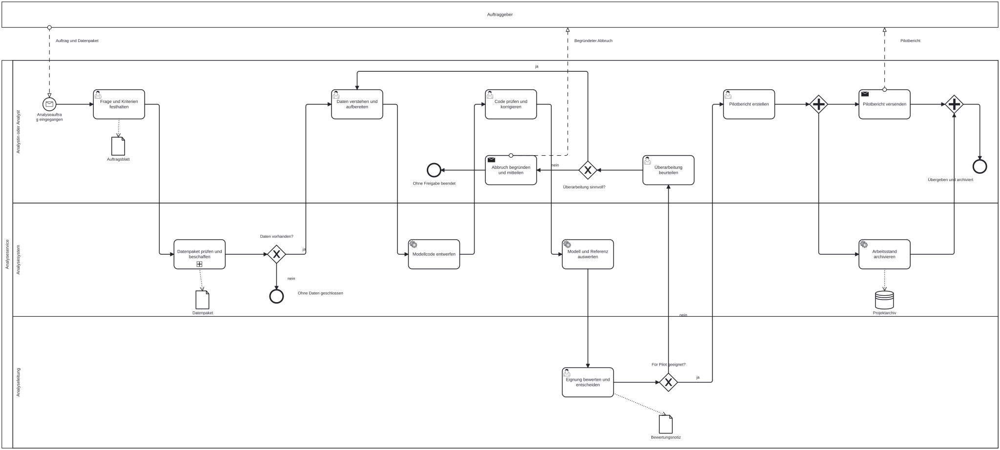


</details>

<details>
<summary>Musterlösung: Datenbereitstellung</summary>

Der Teilprozess beginnt mit „Datenpaket übernommen“. In der System-Lane folgt der zugeklappte Teilprozess „Datei technisch prüfen“ mit parallelem Mehrfach-Marker. Seine drei Instanzen bearbeiten jeweils eine Datei und liefern zusammen drei Prüfvermerke. Das XOR „Alle Dateien verwendbar?“ wartet nicht selbst auf Instanzen; diese Synchronisation erledigt der Mehrfach-Teilprozess vor seinem Abschluss.

Bei Ja endet die Datenbereitstellung mit „Daten vorhanden“. Bei Nein führt die Analystin oder der Analyst die Sendeaufgabe „Korrekturpaket anfordern“ aus. Danach wartet ein ereignisbasiertes Gateway auf das vollständige Ersatzpaket oder fünf Kalendertage. Die Nachricht führt zurück zur Dateiprüfung; der Timer führt zu „Schließung mitteilen“ und zum Ende „Auftrag ohne Daten geschlossen“.

Die drei Nachrichtenflüsse verbinden den Analyseservice mit dem externen Auftraggeber: Korrekturanforderung hinaus, Ersatzpaket hinein, Schließungsmitteilung hinaus. Die Detailansicht zeigt damit Aufgaben zweier interner Rollen innerhalb desselben Teilprozesses.

[BPMN-Datei herunterladen](bpmn/material/data-analytics-genai/bpmn/case/datenbereitstellung.bpmn) · [Diagramm als SVG öffnen](bpmn/material/data-analytics-genai/bpmn/case/datenbereitstellung.svg)

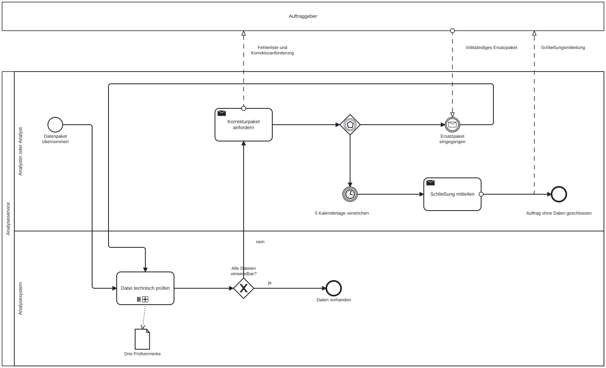


</details>

<details>
<summary>Musterlösung: Technische Dateiprüfung</summary>

Die innere Struktur bezieht sich auf genau eine Datei. Ein einfaches Startereignis „Dateiprüfung begonnen“ führt zu einem AND-Gateway.

Ein Zweig enthält die Serviceaufgabe „Erforderliche Spalten prüfen“. Der andere enthält die Serviceaufgabe „Monatsformat prüfen“. Beide liefern einen Prüfstatus. Ein AND-Gateway wartet auf beide Zweige.

Danach erstellt die Serviceaufgabe „Prüfvermerk erstellen“ einen Vermerk mit beiden Statuswerten und dem Dateinamen. Das Endereignis heißt „Dateiprüfung abgeschlossen“. Ein nicht bestandener Test ist hier ein Prüfergebnis; er beendet keinen parallelen Zweig vorzeitig.

Der parallele Mehrfach-Marker im Datenbereitstellungsmodell startet diese innere Struktur einmal für jede der drei Dateien. Es gibt keine vorzeitige Abschlussbedingung. Die Datenbereitstellung wartet auf alle drei Vermerke. Erst dessen anschließendes XOR entscheidet anhand sämtlicher Ergebnisse über Analyse oder Korrekturanforderung.

Die drei parallelen Instanzen und die zwei parallelen Prüfungen innerhalb jeder Instanz sind unterschiedliche Ebenen. Der Mehrfach-Marker wiederholt dieselbe Struktur für mehrere Dateien; das AND-Gateway verzweigt innerhalb einer einzelnen Dateiprüfung.

[BPMN-Datei herunterladen](bpmn/material/data-analytics-genai/bpmn/case/dateipruefung.bpmn) · [Diagramm als SVG öffnen](bpmn/material/data-analytics-genai/bpmn/case/dateipruefung.svg)

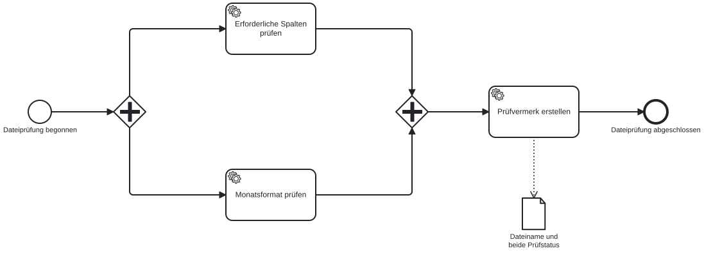


</details>

## Quellen

Data Science Lifecycle, Originalfolien: [PDF](https://docs.google.com/presentation/d/1LR0LmvKFycE3MIjfDEp6L_bGdJtCOe60rFycWIYayBI/export/pdf) · [Slides](https://docs.google.com/presentation/d/1LR0LmvKFycE3MIjfDEp6L_bGdJtCOe60rFycWIYayBI/preview){target="_blank" rel="noopener"}

[Business Process Model and Notation, Version 2.0.2](https://www.omg.org/spec/BPMN/2.0.2)
